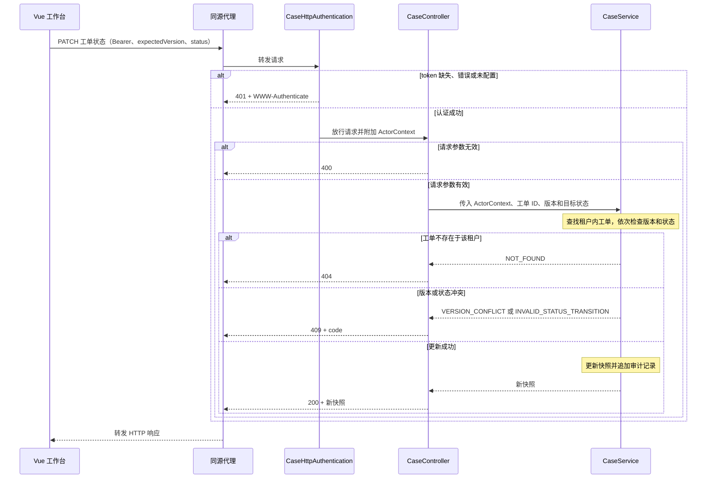

# Java 工单规格

## 范围与数据

Vue 工作台通过同源代理调用 Java 工单 API。服务以 `(tenantId, caseId)` 为键在内存中保存工单及审计记录，进程重启后清空。HTTP 接口用于本地联调，Bearer token 绑定到服务端配置的单个租户和操作者。请求体和请求头中的身份字段无法覆盖这个绑定。审计记录仅供 Java 服务读取。

创建时状态为 `OPEN`，版本为 `1`。状态只允许 `OPEN → IN_REVIEW → CLOSED`，`CLOSED` 为终态。每次成功流转将版本加 `1`，并与审计记录一起写入。审计记录包含租户、操作者、工单 ID、操作、时间、版本和状态变化。两个请求同时提交同一版本时，最多一个能成功更新。

## API 设计

工单请求使用 `Authorization: Bearer <token>`。写请求的请求体为 `application/json`。三个成功响应都包含 `id`、`title`、`status`、`version`。`caseId` 使用 UUID。

| 方法与路径 | 请求 | 成功响应 |
| --- | --- | --- |
| `POST /api/v1/cases` | `title` 为非空白字符串 | `201 Created`，`Location` 指向新工单 |
| `GET /api/v1/cases/{caseId}` | 路径中的工单 ID | `200 OK`，返回当前快照 |
| `PATCH /api/v1/cases/{caseId}/status` | `expectedVersion` 为正整数，`status` 为目标状态 | `200 OK`，返回更新后的快照 |

[OpenAPI 契约](../contracts/openapi/public.yaml)

## 状态更新时序

## 错误处理

| HTTP 状态 | 触发条件及处理方式 |
| --- | --- |
| `400 Bad Request` | JSON 格式、UUID 或字段值无效。修正输入后重新提交。 |
| `401 Unauthorized` | token 缺失、无效或服务未配置 token。响应带有 `WWW-Authenticate: Bearer`。检查联调配置和请求头。 |
| `404 Not Found` | 工单不存在或属于其他租户。两种情况返回相同状态。更新接口返回 `code=NOT_FOUND`。 |
| `409 Conflict` | `VERSION_CONFLICT` 时先查询最新工单，再决定是否以新版本提交。`INVALID_STATUS_TRANSITION` 时应选择合法的下一状态。 |

失败的状态更新不修改快照和审计记录。未配置 token 时工单 API 返回 `401`，公开的 `GET /api/v1/health` 仍可访问。配置了 token 时，无效的 token 格式或空白身份会导致 Java 服务启动失败。

## 验证方式

- 在仓库根目录使用 JDK 21 运行 `mvn -f apps/business-api/pom.xml test`。`CaseServiceTest` 覆盖流转、审计、租户隔离和并发版本冲突。`CaseControllerTest` 通过 MockMvc 覆盖 HTTP 成功路径、鉴权、坏请求和冲突响应。
- 在可丢弃的 Docker Compose 环境配置联调身份和 token，运行 `make up`。让当前 PowerShell 的 `PROOFFLOW_CASES_TOKEN` 与服务配置一致，然后运行 `make test-case-integration`。如前端入口使用其他端口，同时设置 `PROOFFLOW_SMOKE_URL`。测试经前端代理验证鉴权、创建、查询、更新和旧版本冲突，并写入一张合成工单。
- 手工验证 Vue 工作台时，填入联调 token，创建工单，按 ID 查询，再依次更新到 `IN_REVIEW` 和 `CLOSED`。操作步骤见 [工单 API 联调指南](case-api.md)。
